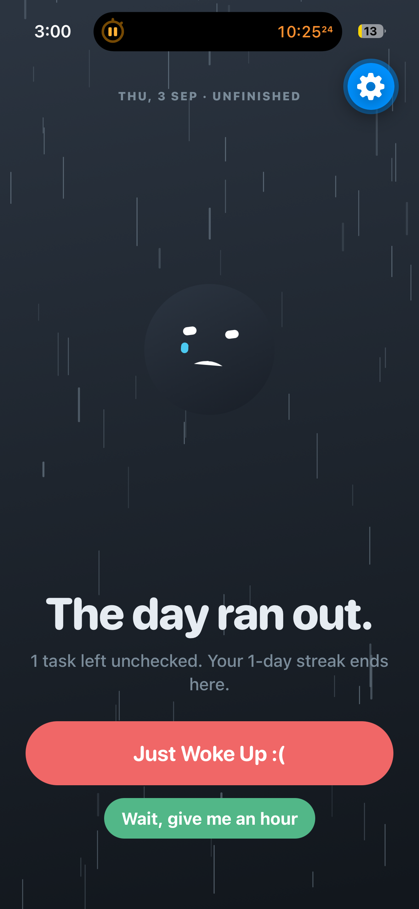
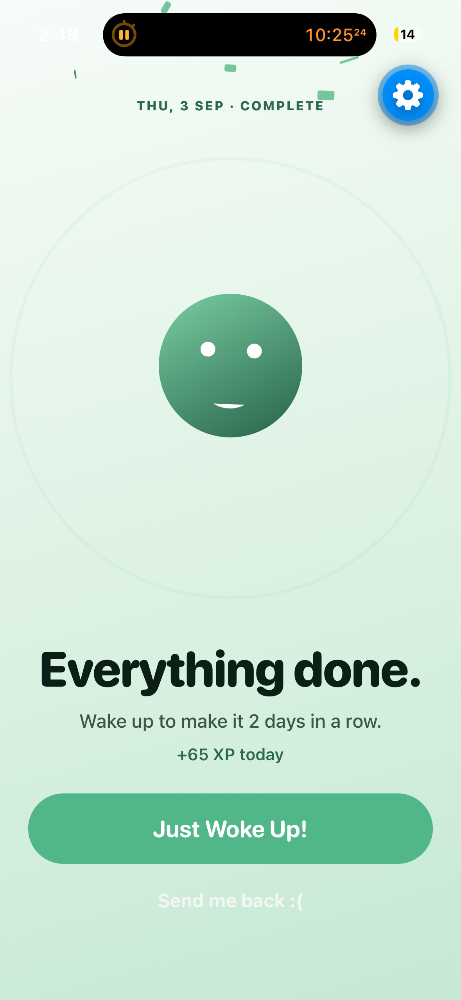
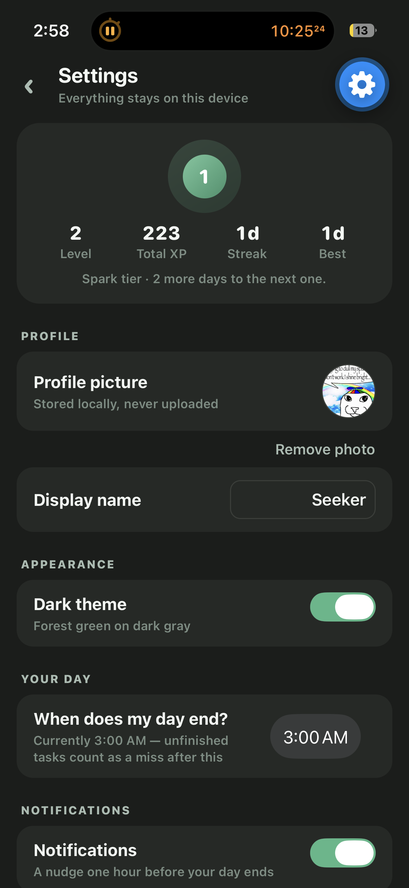
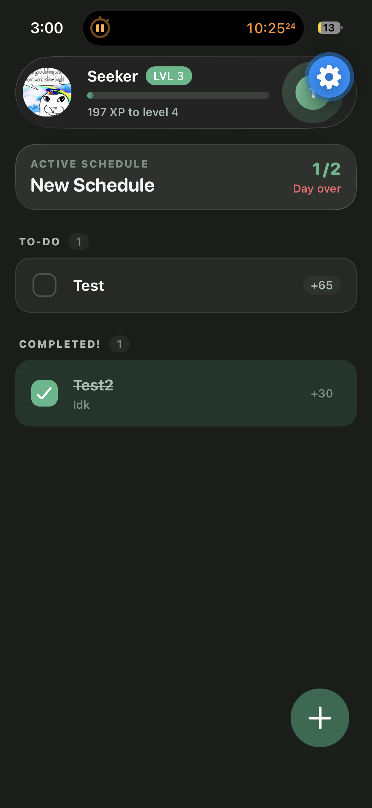

# ScheduleWith - iOS Scheduling App

An Expo-developed iOS exclusive streak-based app that handles **daily schedules**, and grants you XP and cool animations upon completing your tasks. The app will require no WiFi connection and all data is stored locally. Tasks will have varying XP gains, with some tasks having for example +10 and some having +20. 

The goal is simplicity, so there is only one ACTIVE schedule (with other schedules being able to be loaded anytime the user wants) which the user can edit anytime and the list has 2 sections: "To-Do" and "Completed!".

App's main incentive is cool animations, simplicity, streaks and a levelling-system to trigger the dopamine systems in the brain. As such, these will be the main focus and should be properly refined.

Users can also load or export schedules with a + button in the bottom right, that lets you create, load schedules OR export them as a .json. A user can have MANY schedules (in a list in the settings section) where it caches (on disk)/saves the loaded/created schedules, but they can only have ONE active schedule which will primarily show in the UI. The other (non-active) schedules that are being stored can also be deleted, edited, made active, or moved up and down.

There is NO account system. User data (schedules, pfp, display name and other settings) are stored locally.

## Building

## Preview

  
  
  
  

